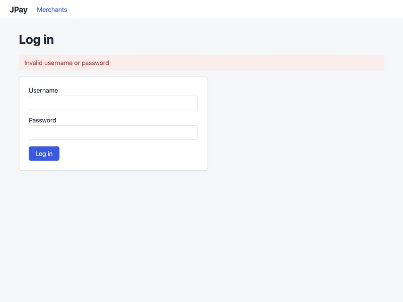
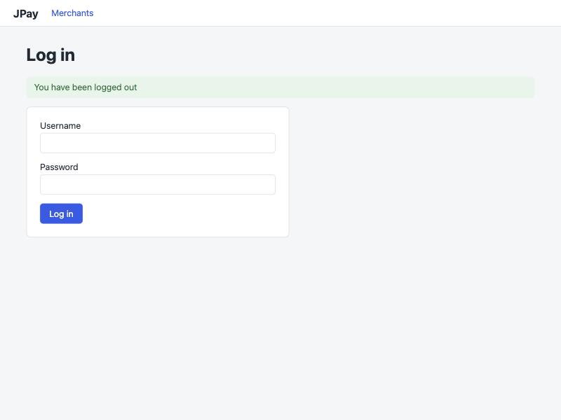
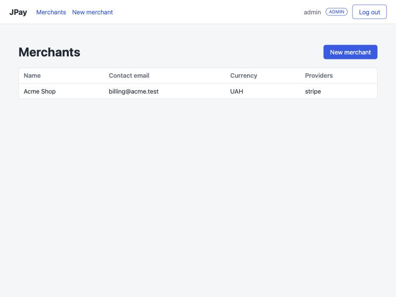
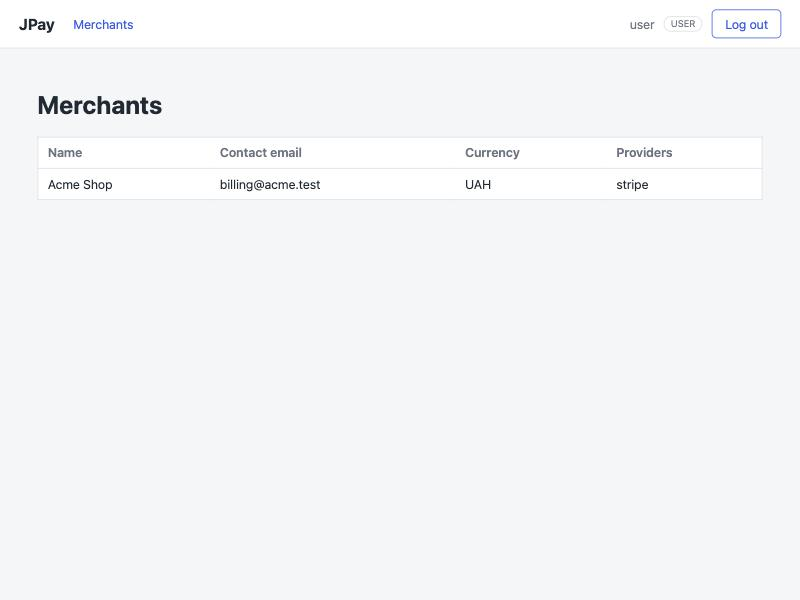
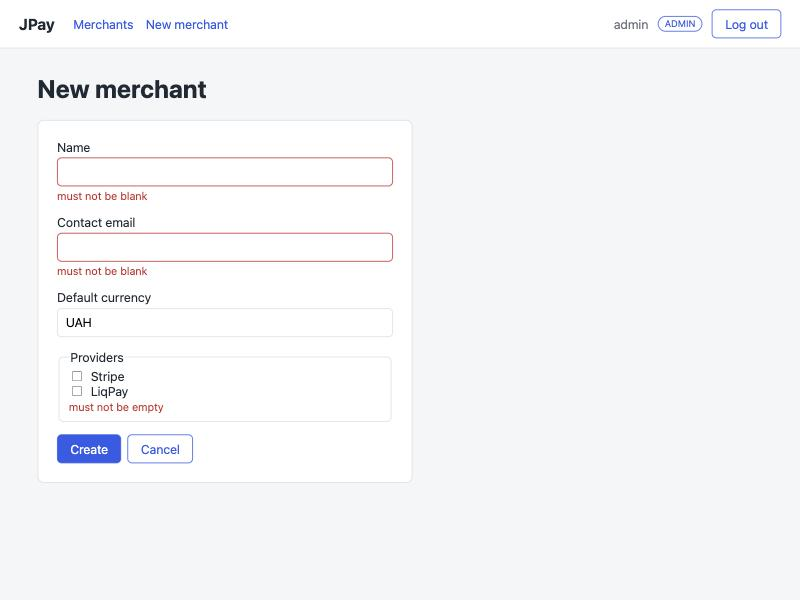
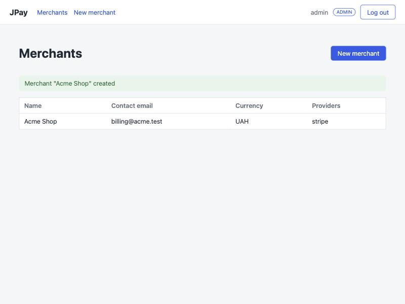
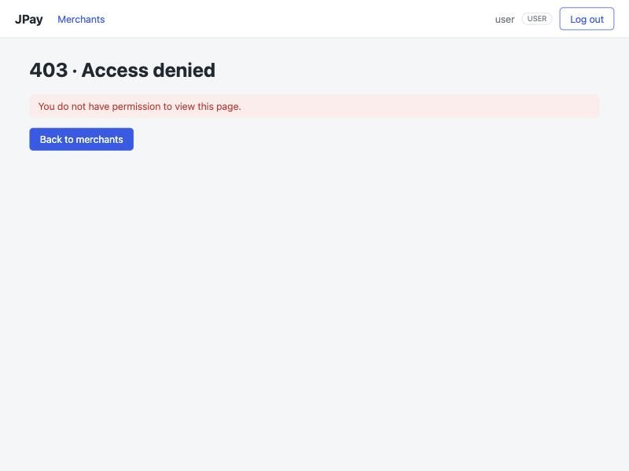
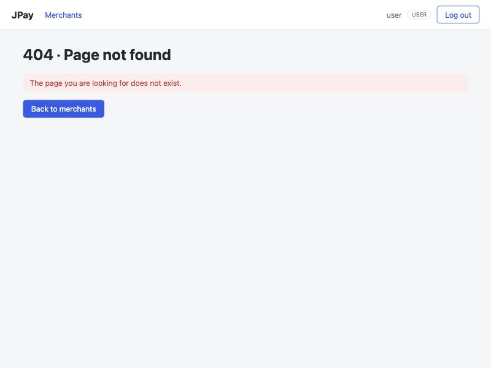

# JPay: ролі, вхід і сторінки помилок — звіт

## 1. Два ланцюги безпеки (`SecurityConfig`)

| | `apiSecurityFilterChain` (`@Order(1)`) | `webSecurityFilterChain` (`@Order(2)`) |
|---|---|---|
| Охоплює | `/api/**` | усе інше (сторінки) |
| Автентифікація | JWT (`JwtAuthenticationFilter`) | форма входу `/login` |
| Стан | stateless, без сесії | сесія (`JSESSIONID`) |
| CSRF | вимкнено | увімкнено (токен у формах через `th:action`) |
| Помилки | JSON: `CustomAuthenticationEntryPoint`, `CustomAccessDeniedHandler` | редирект на `/login`; 403/404 → `templates/error/*.html` |
| Відкриті шляхи | `/api/v1/auth/**`, `/api/v1/webhooks/**` | `/css/**`, `/error`, `/login` |

Чому так: API викликають клієнти без браузера з токеном, тому сесія і CSRF там не потрібні. Браузерні сторінки
працюють із сесією, тому для них CSRF обов'язковий.

## 2. Ролі

Ролі `ROLE_ADMIN` і `ROLE_USER` зберігаються в таблиці `users`. `JpaUserDetailsService` завантажує користувача
за логіном і віддає його роль як `GrantedAuthority`. Обидва ланцюги використовують той самий `UserDetailsService`.

| Можливість | USER | ADMIN |
|---|---|---|
| Увійти, переглянути список мерчантів `/merchants` | так | так |
| Бачити кнопку й пункт меню «New merchant» | ні | так |
| Відкрити `/merchants/new`, створити мерчанта (`POST /merchants`) | ні (403) | так |
| `GET /api/v1/merchants` (`@PreAuthorize`) | ні (403) | так |

## 3. Подвійна перевірка

1. **Інтерфейс (`sec:authorize`)**: кнопка «New merchant» у `merchants/list.html`, пункт у навігації
   `fragments/layout.html` і бейдж ролі показуються за `hasRole('ADMIN')`. Це лише зручність: хто не має прав,
   просто не бачить елемент.
2. **Сервер**: це справжній захист, бо запит можна надіслати й без кнопки.
   - У `webSecurityFilterChain`: `/merchants/new` і `POST /merchants` → `hasRole("ADMIN")`.
   - `@PreAuthorize("hasRole('ADMIN')")` на `createForm` і `create` у `MerchantPageController`
     (другий рівень, діє, навіть якщо правило в ланцюгу зміниться).
   - REST: `@PreAuthorize` уже стоїть на `MerchantController.list()`.

Перевірено вручну: `user` на `/merchants/new` отримує сторінку 403. `POST /merchants` від `user`
(з коректним CSRF-токеном, через `fetch`) теж повертає 403.

## 4. Що змінено

- `security/LoginPageController` — `GET /login` → шаблон `login`.
- `templates/login.html` — форма входу, повідомлення `?error` і `?logout`.
- `SecurityConfig` — `loginPage("/login")`, правила `hasRole("ADMIN")`.
- `templates/error/403.html`, `templates/error/404.html` — з тими самими фрагментами й посиланням на список мерчантів.
- `fragments/layout.html`, `merchants/list.html` — `sec:authorize`, бейдж ролі; `app.css` — стилі бейджа.
- `MerchantPageController` — `@PreAuthorize` на `createForm` і `create`.

## 5. Знімки екрана (`docs/screenshots/`)

| Сторінка | Файл |
|---|---|
| Помилка входу | `01-login-error.jpg` |
| Сторінка входу після виходу (`?logout`) | `02-login-logout.jpg` |
| Список під admin (з кнопкою) | `03-list-admin.jpg` |
| Список під user (без кнопки) | `04-list-user.jpg` |
| Форма з помилками валідації | `05-form-validation.jpg` |
| Повідомлення після створення мерчанта | `06-created-message.jpg` |
| 403 під user | `07-403-user.jpg` |
| 404 | `08-404.jpg` |

