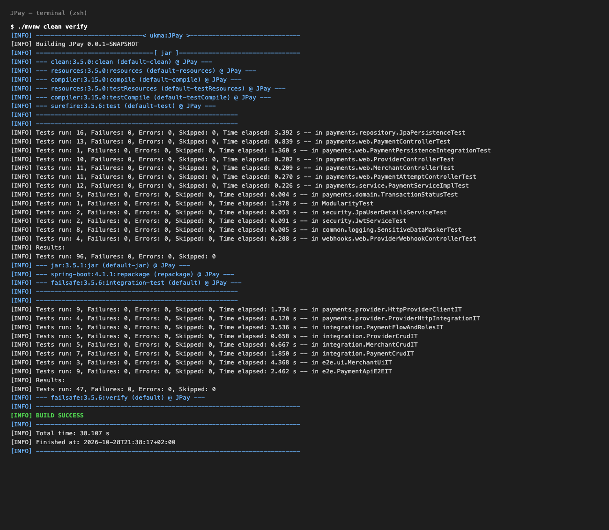
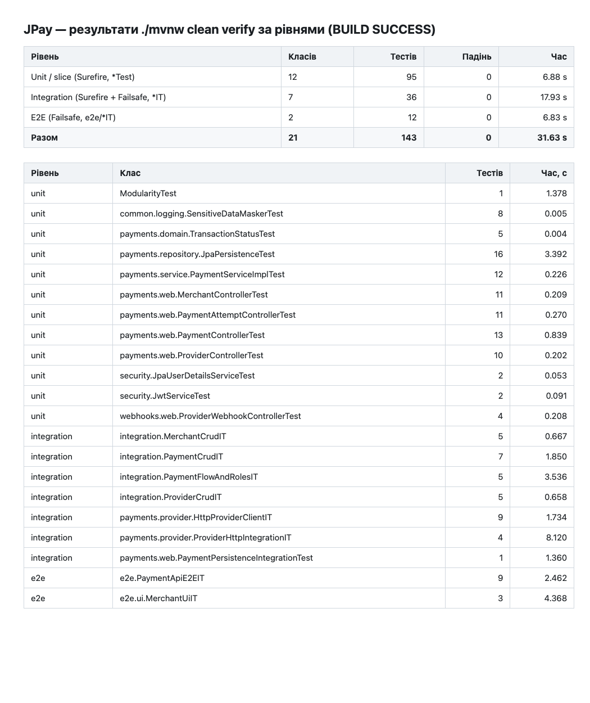

# JPay: тести платежів, ролей, WireMock і E2E — звіт

Запуск: `./mvnw clean verify` (на Windows те саме, що `.\mvnw.cmd clean verify`). Потрібен запущений Docker (Testcontainers
піднімає PostgreSQL) і Chromium для Playwright (завантажується автоматично при першому запуску). Результат:
**BUILD SUCCESS**, 143 тести, 0 падінь, 0 пропущених, 38 с.

## 1. Структура тестів за рівнями

Дані взято з `target/surefire-reports` (класи `*Test`) і `target/failsafe-reports` (класи `*IT`).
Surefire працює на фазі `test`, Failsafe на фазах `integration-test` і `verify`.

| Рівень | Що входить | Класів | Тестів | Падінь | Час |
|---|---|---|---|---|---|
| Unit / slice | Surefire: Mockito, `@WebMvcTest`, `@DataJpaTest`, Modulith | 12 | 95 | 0 | 6,88 с |
| Integration | `PaymentPersistenceIntegrationTest` (Surefire) і 6 класів `*IT` (Failsafe, PostgreSQL у Testcontainers, WireMock) | 7 | 36 | 0 | 17,93 с |
| E2E | `e2e/PaymentApiE2EIT` (REST через `RestTestClient`) і `e2e/ui/MerchantUiIT` (Playwright) | 2 | 12 | 0 | 6,83 с |
| **Разом** | | **21** | **143** | **0** | **31,63 с** |

Час — сума часу класів зі звітів; загальний час збірки 38,1 с.

| Рівень | Клас | Тестів | Час, с |
|---|---|---|---|
| unit | `ModularityTest` | 1 | 1,378 |
| unit | `SensitiveDataMaskerTest` | 8 | 0,005 |
| unit | `TransactionStatusTest` | 5 | 0,004 |
| unit | `JpaPersistenceTest` | 16 | 3,392 |
| unit | `PaymentServiceImplTest` | 12 | 0,226 |
| unit | `MerchantControllerTest` | 11 | 0,209 |
| unit | `PaymentAttemptControllerTest` | 11 | 0,27 |
| unit | `PaymentControllerTest` | 13 | 0,839 |
| unit | `ProviderControllerTest` | 10 | 0,202 |
| unit | `JpaUserDetailsServiceTest` | 2 | 0,053 |
| unit | `JwtServiceTest` | 2 | 0,091 |
| unit | `ProviderWebhookControllerTest` | 4 | 0,208 |
| integration | `MerchantCrudIT` | 5 | 0,667 |
| integration | `PaymentCrudIT` | 7 | 1,85 |
| integration | `PaymentFlowAndRolesIT` | 5 | 3,536 |
| integration | `ProviderCrudIT` | 5 | 0,658 |
| integration | `HttpProviderClientIT` | 9 | 1,734 |
| integration | `ProviderHttpIntegrationIT` | 4 | 8,12 |
| integration | `PaymentPersistenceIntegrationTest` | 1 | 1,36 |
| e2e | `PaymentApiE2EIT` | 9 | 2,462 |
| e2e | `MerchantUiIT` | 3 | 4,368 |

## 2. Що додано

### Спільна основа

Колега додав `@IntegrationTest` (`@SpringBootTest` на випадковому порту + MockMvc + PostgreSQL у Testcontainers),
статичний `AuthTokens.bearer(mockMvc, user, password)` (токен через справжній `POST /api/v1/auth/login`),
`MerchantCrudIT`, `ProviderCrudIT` і Playwright-тест `MerchantUiIT`. Мої тести використовують ті самі `@IntegrationTest` і
`AuthTokens`; додатково є `support/JpayApi` (допоміжні REST-виклики: мерчант, платіж, вебхук).
У `pom.xml` додано `spring-boot-resttestclient`, WireMock і `argLine` для Failsafe.

### Пункт 1. CRUD платежів і спроб — `integration/PaymentCrudIT` (7 тестів)

Через `JdbcClient` перевіряються таблиці `payments` і `payment_attempts`: створення (платіж `PROCESSING` + перша спроба
`SUBMITTED`), читання за id і списком, `PATCH` посилання, зміна статусу вебхуком (недозволені переходи дають 409, рядок не
змінюється), видалення (лише `FAILED`, спроби видаляються каскадом), валідація (400/404/422, нових рядків немає),
CRUD спроб (`POST`, `GET`, `PATCH` результату, `DELETE`).

### Пункт 2. Ролі і повний шлях — `integration/PaymentFlowAndRolesIT` (5 тестів)

- Мерчант → платіж → спроба → вебхук `PAYMENT_SUCCEEDED` → у `payments.status` значення `SUCCEEDED`.
- `admin` на `GET /api/v1/merchants` отримує 200, `user` 403, без токена 401, зіпсований токен 401.
- Після 403/401 кількість рядків у `merchants`, `payments`, `payment_attempts`, `users` не змінюється; анонімні `POST`
  платежу, спроби, вебхука і `DELETE` теж відхилено без змін у БД.

### Пункт 3. WireMock — справжній HTTP-клієнт провайдера

Пункт застосовний після зміни коду: додано `HttpProviderClient` (`POST {base-url}/v1/payments`, таймаути з'єднання 2 с і
читання 5 с за замовчуванням) та `StripeHttpProviderClient`/`LiqPayHttpProviderClient`. Режим вмикається властивістю
`jpay.providers.<id>.mode=http` (+ `base-url`, `connect-timeout`, `read-timeout`); без неї працюють старі mock-клієнти.

| Відповідь провайдера | Результат у JPay |
|---|---|
| 2xx | платіж створено |
| 4xx | `ProviderRejectedException`, HTTP 422 |
| 5xx, розрив з'єднання, недоступний хост | `ProviderUnavailableException`, HTTP 502 |
| таймаут | `ProviderTimeoutException`, HTTP 504 |

`HttpProviderClientIT` (9 тестів): 200, 201, 500, 503, 402, затримка 2 с при таймауті 300 мс, `CONNECTION_RESET_BY_PEER`,
закритий порт, тіло запиту. `ProviderHttpIntegrationIT` (4 тести) запускає весь застосунок з `mode=http`: при 500, таймауті
й 4xx API відповідає 502/504/422, а в `payments` і `payment_attempts` рядків немає (відкат).

### Пункт 4. E2E — `e2e/PaymentApiE2EIT` (9 тестів)

Застосунок на випадковому порту, `RestTestClient`: відмова без токена і з поганим паролем → логін `admin`/`user` → мерчант →
перевірка ролей → платіж → спроба → вебхук → статус `SUCCEEDED` в API і в БД → заборона `FAILED` і видалення після успіху.

### Пункт 5. Знімки і trace Playwright

Тести `e2e/ui/MerchantUiIT` (3 тести) пишуть знімки й trace у `target/playwright/`; копії лежать у `docs/playwright/`:

| Тест | Знімок | Trace |
|---|---|---|
| адмін створює мерчанта | `adminCreatesMerchant.png` | `adminCreatesMerchant-trace.zip` |
| помилки валідації форми | `invalidFormShowsValidationErrors.png` | `invalidFormShowsValidationErrors-trace.zip` |
| user не може створити мерчанта (403) | `userCannotCreateMerchant.png` | `userCannotCreateMerchant-trace.zip` |

Trace відкривається командою `npx playwright show-trace docs/playwright/<файл>-trace.zip`.
Знімки інтерфейсу з попереднього завдання про ролі лишаються в `docs/screenshots/01…08`.

## 3. Знайдені й виправлені помилки

1. **HTTP-клієнт падав на `POST` з `RST_STREAM: Stream cancelled`.** JDK `HttpClient` за замовчуванням пробує cleartext-оновлення
   до HTTP/2, і для `POST` із тілом частина серверів розриває потік. Знайдено тестами WireMock; виправлено явним
   `HttpClient.Version.HTTP_1_1` у `ProviderHttpConfig`.
2. **Колізія з роботою колеги.** `AuthTokens` і `IntegrationTest` у мене були іншими (H2, бін замість статичного методу). Я перейшов на версії колеги,
   тож усі тести йдуть на PostgreSQL, а імена колонок у перевірках `JdbcClient` стали малими літерами.

## 4. Спостереження, які не змінювались (рішення за вами)

- **Вебхук недоступний провайдерам.** `SecurityConfig` відкриває `/api/v1/webhooks/**`, а контролер лежить на
  `/api/v1/providers/{id}/webhook-events`, тому вебхук вимагає JWT. Справжній Stripe/LiqPay його не надішле.
  `permitAll` без перевірки підпису дозволив би будь-кому ставити платежам `SUCCEEDED`, тому я нічого не міняв.
  `PaymentFlowAndRolesIT` фіксує поточну поведінку: анонімний вебхук дає 401.
- **Ролі лише на списку мерчантів.** Через REST будь-який автентифікований `user` може створювати, змінювати і видаляти
  мерчантів: `@PreAuthorize` стоїть тільки на `GET /api/v1/merchants`.
- **Виклик провайдера всередині транзакції.** `PaymentServiceImpl.create` викликає `submit` у `@Transactional`, тож при
  `mode=http` з'єднання з БД утримується до 5 с.
- **Залежність від Docker.** Під час перевірки Docker Desktop один раз зупинився посеред запуску, і тести з Testcontainers та
  Playwright впали з `Broken pipe`/таймаутом. Після перезапуску Docker все пройшло.

## 5. Що не вдалося перевірити

- Реальні Stripe і LiqPay (тільки WireMock).
- Запуск на Windows (`.\mvnw.cmd`): перевірено лише `./mvnw` на macOS.
